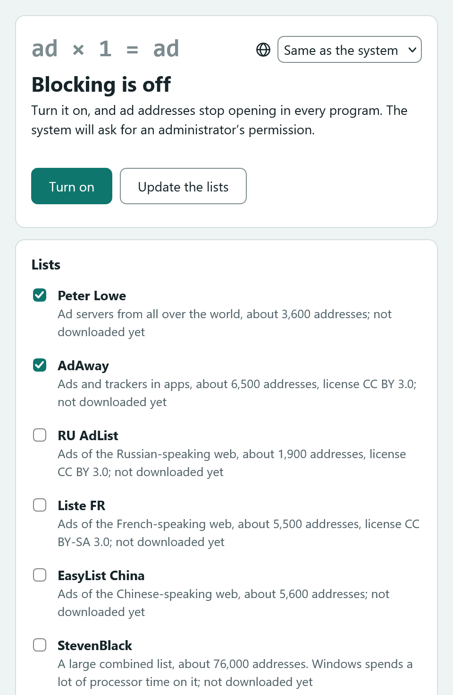

<h1 align="center">ad×0</h1>

<b>ad × 0 = 0</b>

Блакіроўшчык рэкламы для Windows, macOS, Linux і браўзераў

[English](../README.md) · [Русский](README.ru.md) · [Español](README.es.md) · [Ελληνικά](README.el.md) · [עברית](README.he.md) · [简体中文](README.zh.md) · [日本語](README.ja.md) · [한국어](README.ko.md) · [Српски](README.sr.md) · [Français](README.fr.md) · [Deutsch](README.de.md) · [Italiano](README.it.md) · **Беларуская** · [Қазақша](README.kk.md)

ad×0 запісвае адрасы рэкламных сервераў у сістэмны файл hosts і завяршаецца. Пасля гэтага праграмы на камп’ютары нічога не загружаюць з гэтых адрасоў, а ў самога ad×0 няма працэсу, які працуе. Пашырэнне для браўзера хавае рэкламныя блокі на старонках і прыбірае рэкламу з ролікаў YouTube.

## Усталяванне

| Сістэма | Файл | Як усталяваць |
| --- | --- | --- |
| Windows 10, 11 | [adx0-windows.exe](https://github.com/Ilia-Pero/adx0/releases/latest/download/adx0-windows.exe) | Запусціце файл. Калі Windows пакажа папярэджанне, націсніце «Падрабязней», потым «Выканаць у любым выпадку». |
| macOS 10.13+ | [adx0-macos.dmg](https://github.com/Ilia-Pero/adx0/releases/latest/download/adx0-macos.dmg) | Перацягніце праграму ў «Праграмы» і адкрыйце. Пасля першай адмовы macOS адкрыйце сістэмныя налады, «Канфідэнцыяльнасць і бяспека», і націсніце «Усё роўна адкрыць». |
| Ubuntu 24.04+ | [adx0-ubuntu.deb](https://github.com/Ilia-Pero/adx0/releases/latest/download/adx0-ubuntu.deb) | `sudo apt install ./adx0-ubuntu.deb` |
| Firefox 128+ | [adx0-firefox.zip](https://github.com/Ilia-Pero/adx0/releases/latest/download/adx0-firefox.zip) | Адкрыйце `about:debugging`, «Гэты Firefox», «Загрузіць часовае дапаўненне» і выберыце файл. Пасля перазапуску Firefox загрузіце яго зноў. |
| Chrome, Edge, Opera, Яндэкс Браўзер | [adx0-chrome.zip](https://github.com/Ilia-Pero/adx0/releases/latest/download/adx0-chrome.zip) | Распакуйце архіў у папку, якую не будзеце выдаляць. Адкрыйце `chrome://extensions`, уключыце рэжым распрацоўшчыка, націсніце «Загрузіць распакаванае пашырэнне» і выберыце папку. |

Windows і macOS папярэджваюць пра файлы, бо ў іх няма платнага подпісу. GitHub збірае файлы з гэтага рэпазіторыя, усталёўвае праграмы на чыстых машынах і запускае іх, і толькі потым публікуе выпуск.

Пры выдаленні праграма прыбірае заблакіраваныя адрасы з файла hosts. На macOS выключыце блакіроўку да выдалення.

## Праграма

- Блакіруе каля 10 тысяч адрасоў рэкламных сервераў і лічыльнікаў. Спісы выбіраеце вы, можна дадаць свае сайты.
- Не чапае вашых радкоў у файле hosts, перад першай праўкай робіць яго копію, а пасля запісу правярае файл.
- Абнаўляе спісы не часцей за раз у суткі, неўзабаве пасля запуску сістэмы і без акна. Гэта можна выключыць.
- 14 моў.

Файл hosts блакіруе адрасы цалкам, таму рэклама з таго ж адраса, што і змест, застаецца. Праграмы, якія працуюць праз проксі або VPN з уласным пошукам адрасоў, файл hosts абыходзяць.

## Пашырэнне для браўзера

- Блакіруе каля 64 тысяч адрасоў і хавае рэкламныя блокі на старонках.
- Прыбірае расклад рэкламы з адказаў YouTube.
- Дазваляе рэкламу на сайце адной кнопкай.
- Абнаўляе спісы раз у суткі.

## Даныя і сетка

Праграма і пашырэнне спампоўваюць спісы з іх сайтаў і не збіраюць даных. Пра новую версію праграма пытаецца ў GitHub, калі вы націскаеце «Праверыць абнаўленні».

## Падрабязней

Спісы і іх ліцэнзіі, вымярэнні, правераныя сістэмы і зборка апісаны [па-англійску](../README.md) і [па-руску](README.ru.md).

Гэты тэкст перакладзены машынай, носьбіты мовы яго не правяралі. Памылкі можна выправіць у папцы `docs`.

[MIT](../LICENSE)
