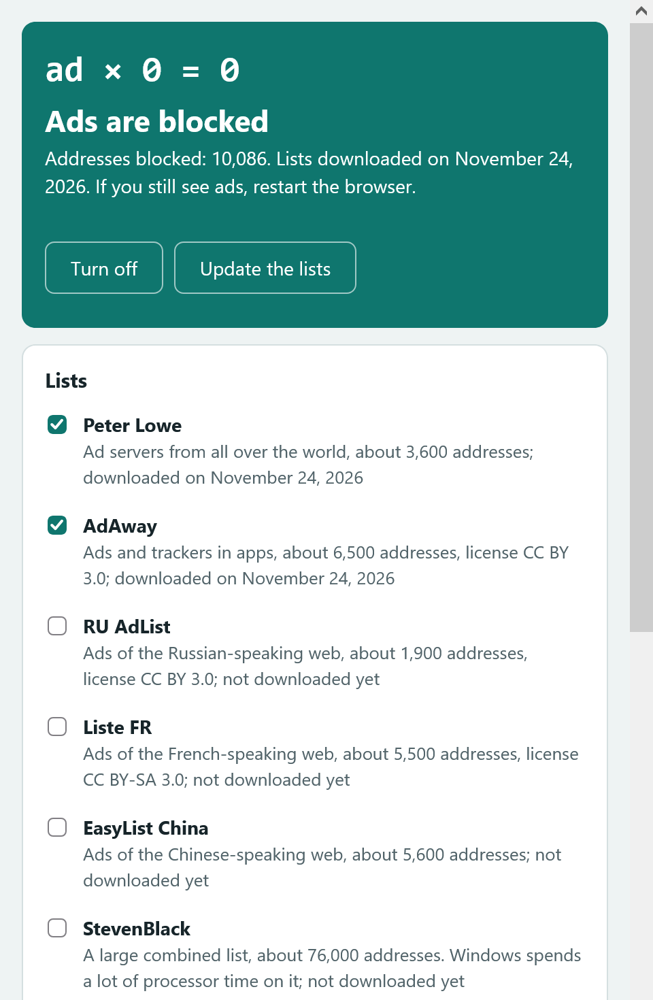

<h1 align="center">ad×0</h1>

<b>ad × 0 = 0</b>

Bloqueador de publicidad para Windows, macOS, Linux y navegadores

[English](../README.md) · [Русский](README.ru.md) · **Español** · [Ελληνικά](README.el.md) · [עברית](README.he.md) · [简体中文](README.zh.md) · [日本語](README.ja.md) · [한국어](README.ko.md) · [Српски](README.sr.md) · [Français](README.fr.md) · [Deutsch](README.de.md) · [Italiano](README.it.md) · [Беларуская](README.be.md) · [Қазақша](README.kk.md)

ad×0 escribe las direcciones de los servidores de publicidad en el archivo hosts del sistema y termina. Después, los programas del ordenador no cargan nada de esas direcciones, y ad×0 no tiene ningún proceso en marcha. Una extensión oculta los bloques de publicidad en las páginas y quita los anuncios de los vídeos de YouTube.

## Instalación

| Sistema | Archivo | Cómo instalarlo |
| --- | --- | --- |
| Windows 10, 11 | [adx0-windows.exe](https://github.com/Ilia-Pero/adx0/releases/latest/download/adx0-windows.exe) | Ejecute el archivo. Si Windows muestra una advertencia, elija «Más información» y después «Ejecutar de todas formas». |
| macOS 10.13+ | [adx0-macos.dmg](https://github.com/Ilia-Pero/adx0/releases/latest/download/adx0-macos.dmg) | Arrastre el programa a Aplicaciones y ábralo. Después del primer rechazo de macOS, abra Ajustes del Sistema, «Privacidad y seguridad», y pulse «Abrir igualmente». |
| Ubuntu 24.04+ | [adx0-ubuntu.deb](https://github.com/Ilia-Pero/adx0/releases/latest/download/adx0-ubuntu.deb) | `sudo apt install ./adx0-ubuntu.deb` |
| Firefox 128+ | [adx0-firefox.zip](https://github.com/Ilia-Pero/adx0/releases/latest/download/adx0-firefox.zip) | Abra `about:debugging`, «Este Firefox», «Cargar complemento temporal» y elija el archivo. Después de reiniciar Firefox hay que cargarlo de nuevo. |
| Chrome, Edge, Opera, Yandex Browser | [adx0-chrome.zip](https://github.com/Ilia-Pero/adx0/releases/latest/download/adx0-chrome.zip) | Descomprima el archivo en una carpeta que vaya a conservar. Abra `chrome://extensions`, active el modo de desarrollador, pulse «Cargar extensión sin empaquetar» y elija la carpeta. |

Windows y macOS avisan porque los archivos no tienen una firma de pago. GitHub los compila a partir de este repositorio, instala los programas en equipos limpios y los inicia antes de publicar una versión.

Al desinstalar, el programa quita las direcciones bloqueadas del archivo hosts. En macOS desactive antes el bloqueo.

## Programa

- Bloquea unas 10 000 direcciones de servidores de publicidad y rastreo. Usted elige las listas y puede añadir sus propios sitios.
- No toca sus líneas del archivo hosts, guarda una copia antes del primer cambio y comprueba el archivo después de escribirlo.
- Actualiza las listas como máximo una vez al día, poco después de iniciarse el sistema y sin ventana. Se puede desactivar.
- 14 idiomas.

El archivo hosts bloquea direcciones completas, por eso queda la publicidad que llega de la misma dirección que el contenido. Los programas con proxy o VPN que buscan las direcciones por su cuenta lo evitan.

## Extensión del navegador

- Bloquea unas 55 000 direcciones y oculta bloques de publicidad en las páginas.
- Quita el plan de anuncios de las respuestas de YouTube.
- Permite la publicidad en un sitio con un botón.
- Actualiza las listas una vez al día.

## Datos y red

El programa y la extensión descargan las listas de sus sitios y no recogen datos. El programa pregunta a GitHub por una versión nueva cuando pulsa «Buscar actualizaciones».

## Más información

Las listas y sus licencias, las mediciones, los sistemas comprobados y la compilación se describen [en inglés](../README.md).

Este texto es una traducción automática que no han revisado hablantes nativos. Las correcciones van en la carpeta `docs`.

[MIT](../LICENSE)
