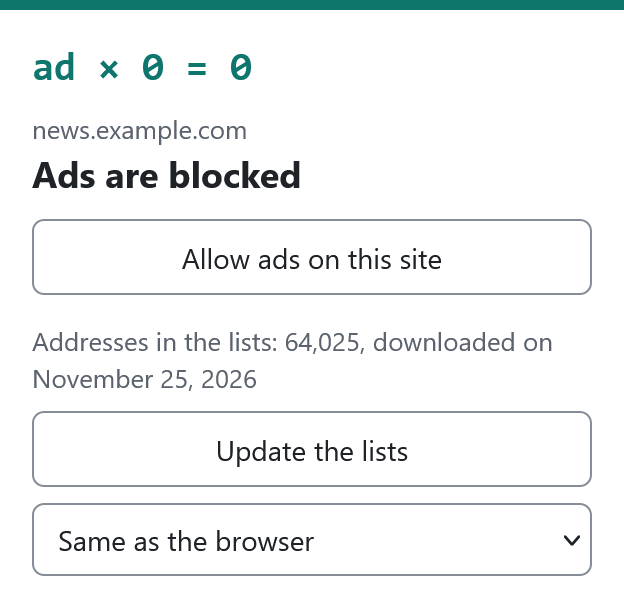

<p align="center"></p>

<h1 align="center">ad×0</h1>

<p align="center"><b>ad × 0 = 0</b></p>

<p align="center">Блокировщик рекламы для Windows, macOS, Linux и браузеров</p>

<p align="center">
<a href="https://github.com/Ilia-Pero/adx0/actions/workflows/build.yml"></a>
<a href="../LICENSE"></a>
<a href="https://github.com/Ilia-Pero/adx0/releases/latest"></a>

</p>

[English](../README.md) · **Русский** · [Español](README.es.md) · [Ελληνικά](README.el.md) · [עברית](README.he.md) · [简体中文](README.zh.md) · [日本語](README.ja.md) · [한국어](README.ko.md) · [Српски](README.sr.md) · [Français](README.fr.md) · [Deutsch](README.de.md) · [Italiano](README.it.md) · [Беларуская](README.be.md) · [Қазақша](README.kk.md)

<p align="center">


</p>

ad×0 записывает адреса рекламных серверов в системный файл hosts и завершается. После этого программы на компьютере ничего не загружают с этих адресов, а у самого ad×0 нет работающего процесса. Остальное делает расширение для браузера: скрывает рекламные блоки на страницах и убирает рекламу из роликов YouTube.

## Установка

| Система | Файл | Как установить |
| --- | --- | --- |
| Windows 10 и 11 | [adx0-windows.exe](https://github.com/Ilia-Pero/adx0/releases/latest/download/adx0-windows.exe) | Запустите файл. Если Windows покажет предупреждение, нажмите «Подробнее», затем «Выполнить в любом случае». |
| macOS 10.13 и новее | [adx0-macos.dmg](https://github.com/Ilia-Pero/adx0/releases/latest/download/adx0-macos.dmg) | Перетащите программу в «Программы» и откройте. После первого отказа macOS откройте системные настройки, «Конфиденциальность и безопасность», и нажмите «Подтвердить вход». |
| Ubuntu 24.04 и новее | [adx0-ubuntu.deb](https://github.com/Ilia-Pero/adx0/releases/latest/download/adx0-ubuntu.deb) | `sudo apt install ./adx0-ubuntu.deb` |
| Firefox 128 и новее | [adx0-firefox.zip](https://github.com/Ilia-Pero/adx0/releases/latest/download/adx0-firefox.zip) | Откройте `about:debugging`, «Этот Firefox», «Загрузить временное дополнение» и выберите файл. При закрытии Firefox удаляет такое расширение, после перезапуска его загружают снова. |
| Chrome, Edge, Opera, Яндекс Браузер | [adx0-chrome.zip](https://github.com/Ilia-Pero/adx0/releases/latest/download/adx0-chrome.zip) | Распакуйте архив в папку, которую не будете удалять. Откройте `chrome://extensions`, включите «Режим разработчика», нажмите «Загрузить распакованное расширение» и выберите папку. Яндекс Браузер может выключить расширение, установленное не из магазина. |

Windows и macOS предупреждают о файлах, потому что у них нет платной подписи. GitHub собирает файлы из этого репозитория, устанавливает программы на чистых машинах и запускает их. Только после этого выпуск публикуется.

При удалении программа убирает заблокированные адреса из файла hosts. На macOS выключите блокировку до удаления.

## Программа

- Блокирует около 10 тысяч адресов рекламных серверов и счётчиков, с русским списком около 11,7 тысячи. Списки выбираете вы; можно добавить свои сайты, которые нужно заблокировать или разрешить.
- Не трогает ваши строки в файле hosts, перед первой правкой делает его копию, а после каждой записи перечитывает файл и сверяет.
- Хранит последнюю удачную копию каждого списка, поэтому блокировка работает, даже когда сайт списка недоступен.
- Пропускает сайты из [этого файла](../data/essential.json), например Яндекс, Google и Госуслуги: такой адрес в списке рекламы считается ошибкой списка. Вручную заблокировать их можно.
- Обновляет списки не чаще раза в сутки, вскоре после запуска системы и без окна. Это можно выключить.
- Говорит на 14 языках.

Файл hosts блокирует адреса целиком, поэтому реклама с того же адреса, что и содержимое, остаётся: так устроены YouTube и социальные сети. Программы, которые работают через прокси или VPN с собственным поиском адресов, файл hosts обходят.

## Расширение для браузера

<p align="center"></p>

- Блокирует 55–64 тысячи адресов в зависимости от регионального списка (с русским 64 тысячи) и скрывает рекламные блоки на страницах. Региональные списки выбираются по языкам браузера.
- Убирает расписание рекламы из ответов YouTube, и проигрыватель её не показывает.
- Разрешает рекламу на сайте одной кнопкой.
- Обновляет списки раз в сутки. Правила исполняет сам браузер, он же выгружает фоновую часть расширения, когда она не нужна.

Расширение работает в Firefox и в браузерах на Chromium.

## Данные и сеть

Программа и расширение скачивают списки с сайтов, перечисленных ниже, и данных не собирают. Программа также спрашивает GitHub о новой версии, когда вы нажимаете «Проверить обновления». Учётных записей и платных исключений для рекламы нет.

## Замеры

Windows Server 2022, оптимизированная сборка, 24.11.2026.

| Что измеряли | Результат |
| --- | --- |
| Процессов при закрытом окне | 0 |
| Процессорное время при открытом окне | 0–31 мс за 5 с |
| От запуска до окна | 0,06–0,6 с в четырёх запусках |
| Размер файла программы | 4,4 МБ |
| Прирост файла hosts | 198 КБ на 9 800 адресов, с русским списком 225 КБ на 11 700 |

## Списки

Списки не входят в этот репозиторий. Ваша копия программы скачивает их с их собственных сайтов, у каждого списка своя лицензия.

| Список | Где используется | Лицензия |
| --- | --- | --- |
| [Peter Lowe](https://pgl.yoyo.org/adservers/) | программа и расширение | [McRae GPL](https://pgl.yoyo.org/license/) |
| [AdAway](https://adaway.org/) | программа и расширение | CC BY 3.0 |
| [RU AdList](https://github.com/easylist/ruadlist) | программа и расширение | CC BY 3.0 |
| [Liste FR](https://github.com/easylist/listefr) | программа и расширение | CC BY-SA 3.0 |
| [EasyList China](https://github.com/easylist/easylistchina) | программа и расширение | [GPL 3.0 / CC BY-SA 3.0](https://easylist.to/pages/licence.html) |
| [StevenBlack](https://github.com/StevenBlack/hosts) | программа | MIT |
| [EasyList](https://easylist.to/) | расширение | [GPL 3.0 / CC BY-SA 3.0](https://easylist.to/pages/licence.html) |
| [EasyList Germany](https://github.com/easylist/easylistgermany) | расширение | [GPL 3.0 / CC BY-SA 3.0](https://easylist.to/pages/licence.html) |
| [EasyList Hebrew](https://github.com/easylist/EasyListHebrew) | расширение | [GPL 3.0 / CC BY-SA 3.0](https://easylist.to/pages/licence.html) |
| [EasyList Italy](https://github.com/easylist/easylistitaly) | расширение | [GPL 3.0 / CC BY-SA 3.0](https://easylist.to/pages/licence.html) |
| [EasyList Spanish](https://github.com/easylist/easylistspanish) | расширение | [GPL 3.0 / CC BY-SA 3.0](https://easylist.to/pages/licence.html) |
| [KoreanList](https://github.com/easylist/KoreanList) | расширение | [GPL 3.0 / CC BY-SA 3.0](https://easylist.to/pages/licence.html) |
| [AdGuard Japanese](https://github.com/AdguardTeam/AdguardFilters) | расширение | GPL 3.0 |
| [Greek AdBlock Filter](https://github.com/kargig/greek-adblockplus-filter) | расширение | CC BY-SA 4.0 |

## Где проверено

| Система | Что проверено |
| --- | --- |
| Windows Server 2022 | Работает с настоящими списками на копии файла hosts. |
| Windows Server, машина GitHub | Устанавливается, запускается, блокирует и разблокирует адрес в файле hosts. |
| Windows 10 и 11 | Ещё не проверено. |
| macOS и Ubuntu 24.04, машины GitHub | Собирается, проходит тесты, устанавливается, запускается, блокирует и разблокирует адрес в файле hosts. Вручную не проверено. |
| Ubuntu 26.04, машина GitHub | Устанавливается и запускается. |
| Firefox 161, Edge 158 | Расширение работает. Chrome, Opera и Яндекс Браузер не проверены, им нужен Chromium 120 или новее. |

Если запустите программу на системе, где её ещё не проверяли, [напишите, что получилось](https://github.com/Ilia-Pero/adx0/issues).

## Сборка

Понадобятся Node.js 24 или новее и Rust, на Windows ещё Microsoft C++ Build Tools, на Ubuntu ещё `libwebkit2gtk-4.1-dev librsvg2-dev`.

```sh
git clone https://github.com/Ilia-Pero/adx0
cd adx0
npm ci
npm run tauri build
```

Установщик появится в `src-tauri/target/release/bundle`. Расширение собирают командой `npm ci && npm run build` в папке `extension`, результат лежит в `extension/packed/firefox` и `extension/packed/chrome`. Тесты, устройство кода и правила изменений описаны в [CONTRIBUTING.md](../CONTRIBUTING.md).

## Переводы

Основные языки: русский и английский. Остальные двенадцать переведены машиной, носители языка их не проверяли. Исправления вносят в `locales`, `extension/web/_locales` и `docs`.

## Лицензия

[MIT](../LICENSE)
